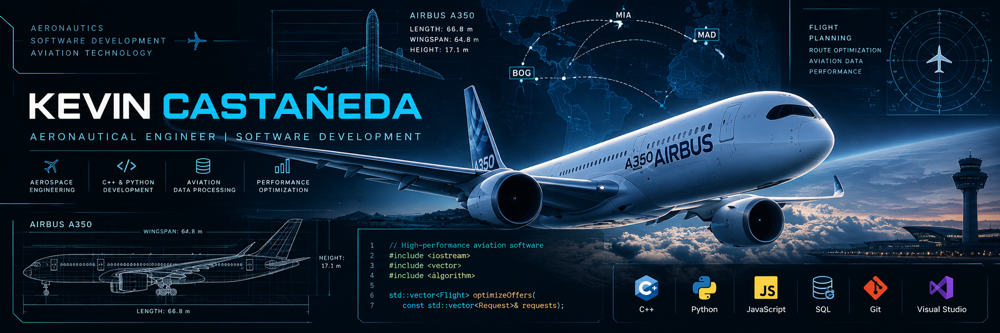

  

---

<h2>About Me</h2>

I'm an Aeronautical Engineer with a background in aircraft maintenance, aerospace engineering, unmanned aircraft systems (UAS), and engineering software projects.

I enjoy developing technology-driven solutions that connect aviation, engineering, and software development.

Currently, I'm strengthening my C++ skills, with a focus on software performance, debugging, algorithms, and efficient programming practices.

## Technical Skills

### Programming & Development

### Aerospace Engineering & Engineering Tools

- Aircraft Systems & Maintenance
- Unmanned Aircraft Systems (UAS)
- Computer-Aided Design (CAD)
- Structural Analysis & Engineering
- Data Visualization & Engineering Analysis

### Currently Learning

- Modern C++ and Memory Management
- Software Performance Optimization
- Debugging and Profiling
- Algorithms and Data Structures

## Featured Aviation Projects

- [Altitude Calculator](https://github.com/TkevinLevin24/Calculadora-Altitud) — Atmospheric calculations for aviation applications.
- [Colombia FIR Map](https://github.com/TkevinLevin24/Mapa-de-FIRs-Colombia) — Geographic visualization of Flight Information Regions.
- [Colombian Airports Map](https://github.com/TkevinLevin24/MapaColombiaAeropuertos.github.io) — Interactive aerodrome mapping project.

## Connect

[GitHub](https://github.com/TkevinLevin24)

---

*Engineering the future of aviation through software and technology.*
